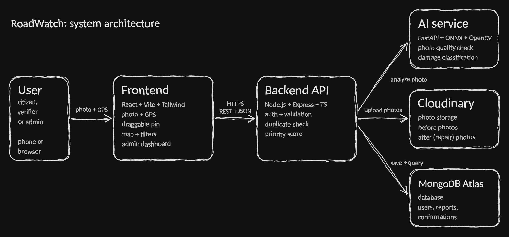
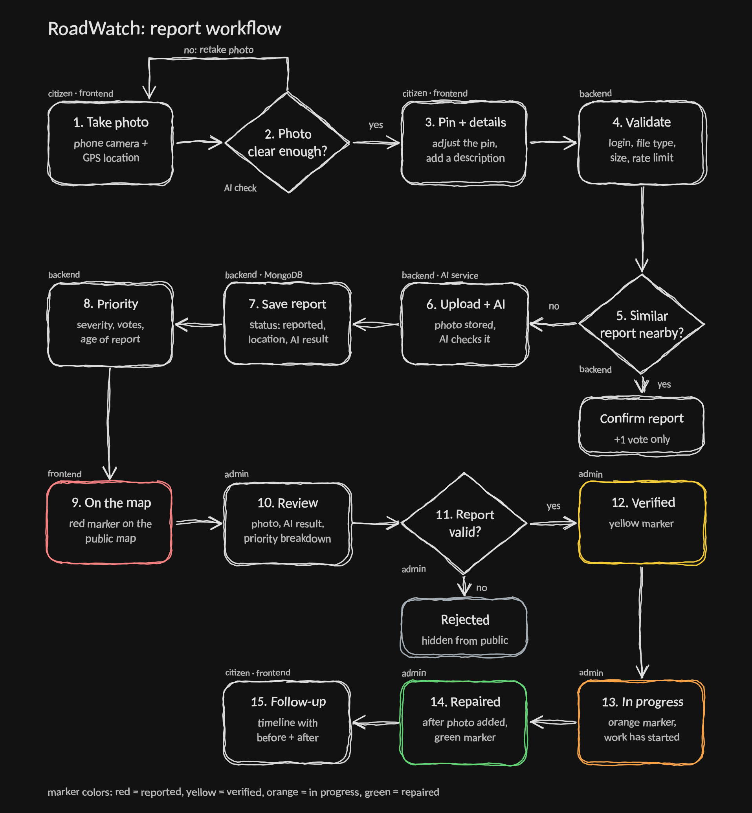

# RoadWatch: Smart Pothole and Road Damage Reporter

A free, mobile-first web app where citizens report potholes and damaged roads with a photo and GPS location. The system checks the photo with AI, links duplicate reports, ranks roads by real-world impact, shows everything on a public map, and tracks each report until the repair is proven with an "after" photo.

> **Status:** in active development by a team of six. See [Project status](#project-status) for what is built and what is planned.

---

## Table of contents

1. [The problem](#the-problem)
2. [The solution](#the-solution)
3. [MVP (minimum viable product)](#mvp-minimum-viable-product)
4. [What makes it unique (USP)](#what-makes-it-unique-usp)
5. [System architecture](#system-architecture)
6. [Tech stack](#tech-stack)
7. [Repository structure](#repository-structure)
8. [Frontend](#frontend)
9. [Backend](#backend)
10. [AI service](#ai-service)
11. [Data model](#data-model)
12. [Getting started](#getting-started)
13. [Environment variables](#environment-variables)
14. [Testing](#testing)
15. [Deployment (zero cost)](#deployment-zero-cost)
16. [Security and privacy](#security-and-privacy)
17. [Team and responsibilities](#team-and-responsibilities)
18. [Project status](#project-status)
19. [Roadmap](#roadmap)
20. [Known limitations](#known-limitations)
21. [Licensing and credits](#licensing-and-credits)

---

## The problem

Road damage is usually reported through phone calls, social media posts, or paper forms. This causes real problems:

- Locations are vague, so crews waste time finding the spot.
- There is no photo evidence and no history.
- Hundreds of complaints arrive with no way to tell which ones matter most.
- Citizens never find out what happened to their complaint.

## The solution

RoadWatch lets a citizen report road damage in under 30 seconds. After that:

1. The photo is checked for quality and for road damage by an AI model.
2. Nearby reports of the same spot are linked together instead of creating duplicates.
3. Each report gets a priority score that the admin can see and explain.
4. Admins verify reports, update the status, and upload a repair photo.
5. Everyone can follow the full lifecycle on a public map.

### Roles

| Role | What they can do |
|---|---|
| **Visitor** (no login) | View the public map, report details, and statistics |
| **Citizen** | Submit reports, confirm other reports, track their own reports |
| **Verifier** (optional) | Verify or reject new reports. Cannot change repair status |
| **Admin / Officer** | Everything above, plus status changes, repair proof, and user management |

---

## MVP (minimum viable product)

The MVP is the smallest version that works end to end. Build and demo this first.

### Must have

| # | Feature | Where |
|---|---|---|
| 1 | Register and log in, with roles (citizen, admin) | Frontend + Backend |
| 2 | Report damage: photo, GPS location, adjustable pin, description | Frontend + Backend |
| 3 | AI check of the photo (damage or not, confidence, quality warning) | AI service |
| 4 | Public map with colored markers by status, popups, and filters | Frontend |
| 5 | Report detail page with status timeline | Frontend + Backend |
| 6 | My reports page | Frontend + Backend |
| 7 | Duplicate handling: "Is this the same pothole?" confirmation | Frontend + Backend |
| 8 | Priority score for each report | Backend |
| 9 | Admin dashboard: report table sorted by priority, verify or reject, update status | Frontend + Backend |
| 10 | Repair proof: admin uploads an "after" photo | Frontend + Backend |

### Stretch goals (after the MVP works)

- Marker clustering and a heatmap layer on the map
- Offline reporting (PWA with a queue)
- Trust score for each report (EXIF, photo age, GPS accuracy)
- Area report card (statistics per ward)
- Email or in-app notifications on status changes
- Verifier queue, user management, analytics charts
- Face blur and number-plate privacy filter
- Damage detection with bounding boxes for real severity
- Open data export (GeoJSON and CSV)

> **Build order tip:** get the basic flow "report, then map pin" working first, even with no AI. Add the AI step after that. A working simple version is better than a half-finished complex one.

---

## What makes it unique (USP)

Many civic apps combine photos and a map. RoadWatch stands out through how it handles trust, duplicates, and priority.

| Feature | What it does | Status |
|---|---|---|
| **Confirm instead of merge** | If a similar report exists nearby, the user is asked "Is this the same pothole?" One tap adds their confirmation, and each user counts once. This avoids silent merging and stops one person from inflating counts. | MVP |
| **Explainable priority score** | The score combines severity, confirmations, age, and road importance. Admins see the breakdown, not just a number. | MVP (basic), stretch (road type, nearby schools and hospitals) |
| **Public status timeline** | Every report shows its full history from reported to repaired, with before and after photos. | MVP |
| **AI as advice, humans in charge** | The AI result helps, but verifiers and admins can override it. Their decisions are stored so the model can improve later. | MVP |
| **Trust score** | Each report gets a trust score from the photo's EXIF location, photo age, GPS accuracy, and AI result. Low-trust reports go to a review queue before reaching the public map. | Stretch |
| **Offline-first** | Reports are saved on the phone when the network is bad and sent later. | Stretch |
| **Privacy by design** | EXIF data is removed before storage, reporter coordinates are not public, and users can delete their data. | MVP (EXIF), stretch (face blur) |
| **Zero running cost** | Designed around free tiers, with an ONNX model small enough for a free server. | MVP |

---

## System architecture

### Architecture



*The browser talks only to the Node backend. The backend calls the AI service, Cloudinary, and MongoDB.*

### Workflow



*From photo to repair. The marker colors match the map: red = reported, yellow = verified, orange = in progress, green = repaired.*

**How a report flows through the system**

1. The user takes a photo and the browser captures the GPS location.
2. The frontend sends the photo, coordinates, and description to the backend.
3. The backend validates the data and checks for nearby unrepaired reports.
4. If a similar report exists, the user is asked to confirm it instead.
5. Otherwise the photo goes to Cloudinary and the report is saved as `reported`.
6. The backend sends the photo to the AI service. The result (confidence, severity, quality) is saved. If the AI is down, the report is still saved.
7. The priority score is calculated and stored.
8. The report appears on the public map. An admin verifies it, updates the status, and finally uploads the repair photo.

**Important rule:** MongoDB stores coordinates as `[longitude, latitude]`, while Leaflet uses `[latitude, longitude]`. The backend converts this in one place, and the API returns separate `latitude` and `longitude` fields.

---

## Tech stack

| Part | Technologies |
|---|---|
| **Frontend** | React, Vite, TypeScript, Tailwind CSS, React Router, Leaflet + react-leaflet, OpenStreetMap tiles, browser Geolocation API |
| **Backend** | Node.js, Express, TypeScript, Mongoose, Zod, JWT, bcrypt, Multer, Cloudinary, helmet, express-rate-limit |
| **AI service** | Python, FastAPI, OpenCV (headless), ONNX Runtime, NumPy |
| **Model training** | PyTorch + torchvision (MobileNetV2 transfer learning) on Google Colab or Kaggle, exported to ONNX |
| **Database** | MongoDB Atlas (free M0) with a `2dsphere` geo index |
| **Testing** | Jest + Supertest (backend), pytest (AI), Postman or Bruno (manual API tests) |
| **Hosting** | Vercel or Cloudflare Pages (frontend), Render (backend and AI), MongoDB Atlas, Cloudinary |

---

## Repository structure

```
RoadWatch/
├── frontend/          React app (user pages, map, admin)
├── backend/           Node + Express API
├── ai-service/        Python FastAPI service
├── ml/                Model training notebooks and scripts (not deployed)
├── docs/              Decisions log, API notes, report material, diagrams
└── README.md
```

The diagrams in this README live in `docs/images/` (`architecture.png` and `workflow.png`).

---

## Frontend

### What it does

The React app is the only thing users see. It captures photos and GPS, shows reports on a map, and gives admins a dashboard. It talks only to the backend API.

### Pages

**Public (no login)**

| Page | Route | What it shows | Tier |
|---|---|---|---|
| Home | `/` | What the app does, report button, live totals | MVP |
| Map | `/map` | OpenStreetMap with colored markers, filters, popups | MVP |
| Report detail | `/reports/:id` | Photo, location, AI result, status timeline, before/after photos | MVP |
| Not found | `*` | Friendly 404 with a link home | MVP |
| Area report card | `/areas` | Statistics per ward | Stretch |
| About and privacy | `/about`, `/privacy` | How the app works, how data is handled | Stretch |

**Citizen (login required)**

| Page | Route | What it does | Tier |
|---|---|---|---|
| Register / Login | `/register`, `/login` | Create an account and sign in | MVP |
| Report damage | `/report` | Camera or upload, GPS, draggable pin, description, AI result, submit | MVP |
| Similar report prompt | (modal) | "Is this the same pothole?" | MVP |
| My reports | `/my-reports` | Your reports and their status | MVP |
| Profile, notifications | `/profile`, `/notifications` | Settings and alerts | Stretch |

**Admin and verifier (role protected)**

| Page | Route | What it does | Tier |
|---|---|---|---|
| Dashboard | `/admin` | Summary cards and charts | MVP |
| Reports table | `/admin/reports` | All reports sorted by priority, with filters | MVP |
| Report review | `/admin/reports/:id` | Photo, AI result, change status, verify or reject, repair photo | MVP |
| Verifier queue, users, analytics | `/admin/verify`, `/admin/users`, `/admin/analytics` | Moderation and statistics | Stretch |

### Frontend structure

```
frontend/src/
├── api/          reportsApi.ts (all backend calls live here)
├── components/   Navbar, PhotoBox, StatusBadge, StatusTimeline, FiltersPanel, ReportMap
├── data/         fakeReports.ts (sample data until the API is ready)
├── pages/        HomePage, MapPage, ReportDetailPage, NotFoundPage, ...
├── types/        report.ts (shared TypeScript types)
├── utils/        statusInfo.ts, formatDate.ts, filterReports.ts
├── App.tsx       routes
├── index.css     Tailwind setup and the hand-drawn "sketch" style
└── main.tsx
```

### Design notes

- The look follows the hand-drawn wireframes: uneven borders, the Patrick Hand font, and soft pastel colors.
- Marker colors by status: red = reported, yellow = verified, orange = in progress, green = repaired.
- Rejected reports are never shown on public pages.
- All backend calls go through `src/api/`, so switching from sample data to the real API only changes that folder.

### Run the frontend

```bash
cd frontend
npm install
npm run dev
```

The app opens at `http://localhost:5173`.

---

## Backend

### What it does

The Express API handles login, validates every request, stores reports, checks for duplicates, calls the AI service, calculates priority, and protects admin routes by role.

### API routes

All routes start with `/api`.

**Auth**

| Method | Route | Access | Purpose |
|---|---|---|---|
| POST | `/auth/register` | Public | Create an account (default role: citizen) |
| POST | `/auth/login` | Public | Check credentials and return the token |
| GET | `/auth/me` | Logged in | Current user and role |
| POST | `/auth/logout` | Logged in | Clear the session |

**Reports**

| Method | Route | Access | Purpose |
|---|---|---|---|
| GET | `/reports` | Public | List reports for the map. Filters: `status`, `severity`, `from`, `to`, `bounds`, `page`, `limit` |
| GET | `/reports/:id` | Public | One report with its status history |
| GET | `/stats` | Public | Totals for the home page |
| POST | `/reports` | Citizen | Create a report (photo, latitude, longitude, description) |
| GET | `/reports/mine` | Citizen | The logged-in user's reports |
| GET | `/reports/nearby` | Citizen | Reports near a point, for the duplicate prompt |
| POST | `/reports/:id/confirm` | Citizen | Confirm an existing report (one per user) |

**Admin and verifier**

| Method | Route | Access | Purpose |
|---|---|---|---|
| GET | `/admin/reports` | Verifier, admin | All reports including rejected, sorted by priority |
| GET | `/admin/reports/:id` | Verifier, admin | Full detail for review |
| PATCH | `/admin/reports/:id/status` | Admin (verifier: verify and reject only) | Change status and log it in the history |
| POST | `/admin/reports/:id/repair-photo` | Admin | Upload the "after" photo |
| GET | `/admin/stats` | Verifier, admin | Counts by status, reports per week, average repair time |
| GET, PATCH | `/admin/users`, `/admin/users/:id/role` | Admin | User management (stretch) |

Define `/reports/mine` and `/reports/nearby` before `/reports/:id`, or Express will read "mine" as an id.

### Backend structure

```
backend/src/
├── config/        env, database connection, Cloudinary
├── models/        User, Report, Confirmation
├── routes/        auth, reports, admin
├── controllers/   the logic behind each route
├── middleware/    requireLogin, requireRole, upload, validate, rateLimit, errorHandler
├── services/      aiClient, duplicateCheck, priority, imageUpload, reportMapper
├── schemas/       Zod validation for request bodies
├── scripts/       seedAdmin
└── server.ts
```

### Key rules

1. The status, priority score, and confirmation count are set by the server only. Never trust the client.
2. Every report leaves the API through one mapper function, so the response always matches the frontend `Report` type.
3. Hide rejected reports on public routes, and never return emails or password hashes.
4. Validate every request body with Zod and limit uploads to images under about 5 MB.
5. If the AI service fails or times out, still save the report with AI status `failed`.

### Priority score

The score combines:

- AI severity (or the admin-set severity)
- Number of confirmations
- Days since the report was made
- Road importance (stretch)

The admin can see each part, so the ranking is explainable.

### Run the backend

```bash
cd backend
npm install
cp .env.example .env     # then fill in the values
npm run dev
```

The API runs at `http://localhost:5000`.

---

## AI service

### What it does

A small separate Python server that looks at one photo and answers: is this road damage, how sure are we, and is the photo good enough? The Node backend is the only caller.

### Routes

| Method | Route | Access | Purpose |
|---|---|---|---|
| GET | `/health` | Public | Returns "ok" and the model version. Also wakes a sleeping server |
| POST | `/analyze` | Secret header required | Analyze one image |

**Response from `/analyze`**

| Field | Meaning |
|---|---|
| `isDamage` | True or false |
| `confidence` | 0 to 1, how sure the model is |
| `severity` | `low`, `medium`, `high`, or `unknown` |
| `quality` | `ok`, `blurry`, `too_dark`, or `too_small` |
| `message` | Short text for the user, such as "Photo is too blurry, please retake" |
| `modelVersion` | Which model produced the result |

### Pipeline

1. Check the secret header (reject with 401 if wrong).
2. Check the file type and size.
3. Decode the image with OpenCV.
4. Quality gate: blur (sharpness), brightness, and size. If a check fails, skip the model and return a message.
5. Resize to 224 px and normalize.
6. Run the ONNX model.
7. Decide `isDamage` using a tuned confidence threshold.
8. Estimate severity (see below).
9. Return the JSON. The image is never saved to disk.

### The model

- **Classes:** pothole or road damage, normal road, not a road.
- **Approach:** transfer learning with MobileNetV2, exported to ONNX and quantized so it is small and fast on a free CPU.
- **Data split:** by source or location, not randomly, so the test score is honest.
- **Targets:** pothole recall of at least 0.85, precision of at least 0.80, and inference under 1 second after warm-up. These are starting targets and will be adjusted with real data.

### Severity: an honest note

A classifier's confidence says how sure the model is, not how bad the damage is. A tiny pothole can score 0.95. So:

- **MVP:** severity is `unknown` or a provisional value, and the admin sets the real severity during review.
- **Upgrade:** a detector draws boxes around damage, and severity comes from box size and count.

### Datasets

| Source | Use |
|---|---|
| Kaggle pothole datasets | Pothole vs normal road (check each licence) |
| RDD2022 (India subset) | Labeled road damage (check the licence and credit it) |
| Our own phone photos | Test set and fine-tuning. The most valuable data for local roads |
| General non-road images | The "not a road" class |

Raw images are never committed to Git. Only manifests and source notes go in `ml/data`.

### AI service structure

```
ai-service/
├── app/
│   ├── main.py         FastAPI routes and secret check
│   ├── quality.py      blur, brightness, size checks
│   ├── preprocess.py   resize and normalize
│   ├── infer.py        ONNX model loading and prediction
│   ├── severity.py     severity logic
│   └── config.py       environment variables
├── models/             model-v1.onnx and model-card.md
├── tests/
├── Dockerfile
└── requirements.txt
```

### Run the AI service

```bash
cd ai-service
python -m venv venv
source venv/bin/activate
pip install -r requirements.txt
uvicorn app.main:app --reload --port 8000
```

Until the trained model is ready, the service can return a fixed dummy response with the same fields, so the backend can be built and tested in parallel.

---

## Data model

**User:** name, email (unique), password hash, role (`citizen`, `verifier`, `admin`), created date.

**Report:**

- Reporter (user id), image URL, after-image URL, description, address
- Location as a GeoJSON Point, with a `2dsphere` index
- Status: `reported`, `verified`, `in_progress`, `repaired`, `rejected`
- Severity, AI confidence, AI status (`pending`, `done`, `failed`)
- Priority score and confirmation count
- Status history: status, date, and who changed it
- Created and updated dates

**Confirmation:** report id, user id, optional photo URL, date. A unique pair of (report, user) stops repeat confirmations.

---

## Getting started

### Prerequisites

- Node.js (current LTS) and npm
- Python 3.11 or newer
- A MongoDB Atlas account (free) or a local MongoDB
- A Cloudinary account (free)
- Git

### Steps

1. Clone the repository and move into it.
2. Set up and run the **backend** (see [Run the backend](#run-the-backend)).
3. Set up and run the **AI service** (see [Run the AI service](#run-the-ai-service)).
4. Set up and run the **frontend** (see [Run the frontend](#run-the-frontend)).
5. Open `http://localhost:5173`.

### Ports used in development

| Part | Port |
|---|---|
| Frontend | 5173 |
| Backend | 5000 |
| AI service | 8000 |

In development, point the Vite dev server's `/api` proxy at the backend port to avoid CORS issues.

---

## Environment variables

Never commit `.env` files. Each part has a `.env.example` listing the names without values.

**Backend**

```
PORT
MONGO_URI
JWT_SECRET
FRONTEND_URL
CLOUDINARY_CLOUD_NAME
CLOUDINARY_API_KEY
CLOUDINARY_API_SECRET
AI_SERVICE_URL
AI_SERVICE_SECRET
```

**AI service**

```
AI_SERVICE_SECRET
MODEL_PATH
MODEL_VERSION
CONFIDENCE_THRESHOLD
BLUR_THRESHOLD
MIN_BRIGHTNESS
MAX_IMAGE_MB
```

`AI_SERVICE_SECRET` must be the same in the backend and the AI service.

---

## Testing

| Area | What to test | Pass condition |
|---|---|---|
| Backend API | Register, login, create report, duplicate prompt, confirm, role access | Correct status codes and data |
| Backend security | Wrong role, missing token, invalid input, oversized file | Clean rejection, no crash |
| Geo queries | Insert known coordinates and search nearby and by map area | Correct results |
| AI service | Clear pothole, normal road, blurry, dark, non-image, wrong secret | Correct flags, no crash, 401 on wrong secret |
| Model quality | Test set and our own phone photos | Meets the recall and precision targets, with a confusion matrix |
| Frontend | Report flow on a real phone: camera, GPS denied, slow network | Clear messages and no broken screens |
| Edge cases | AI service down, missing GPS, large files | Report still saved or a clear error shown |

Tools: Jest + Supertest for the backend, pytest for the AI service, and Postman or Bruno for manual checks.

---

## Deployment (zero cost)

| Part | Free option | Watch out for |
|---|---|---|
| Frontend | Vercel Hobby or Cloudflare Pages | Vercel Hobby is for non-commercial use |
| Backend | Render free web service | Sleeps when idle, so the first request is slow |
| AI service | Hugging Face Space (Docker) or a second Render service | Small memory, which is why the model uses ONNX |
| Database | MongoDB Atlas M0 | 512 MB storage |
| Photos | Cloudinary free plan | Shared monthly credit pool |
| Maps | OpenStreetMap tiles | Fair-use policy and required attribution |

**Free-tier survival rules**

- Compress photos in the browser before upload.
- Paginate every list. Never return all reports at once.
- Keep AI inputs small and the model quantized.
- Design every feature so a cold start only delays it and never breaks it.
- Keep a local setup so a demo can always run from a laptop.

**Day-one check:** free limits change often. Verify each provider's current limits and whether any asks for a payment card, and note them in `docs/FREE_TIER.md`.

---

## Security and privacy

- Passwords are hashed, and `.env` files are never committed.
- Role checks on every protected route, plus rate limiting on login and report submission.
- Server-side validation of every request and file, not only in the browser.
- The AI service accepts calls only with a shared secret header.
- Photo metadata (EXIF) is removed before storage.
- Reporter email and exact location are never shown publicly.
- Users can delete their account and data.
- The AI service never saves images to disk.

---

## Team and responsibilities

| Member | Role | Owns |
|---|---|---|
| M1 | Team lead, backend core, DevOps | Repo setup, database, auth, roles, deployment, CI |
| M2 | Backend, reports engine | Report APIs, image pipeline, duplicates, priority score |
| M3 | AI / ML | Datasets, model training, ONNX export, FastAPI service |
| M4 | Frontend, user flow | Login pages, report form, My reports, offline support |
| M5 | Frontend, map and public pages | Map, filters, report detail, area card |
| M6 | Admin, QA, documentation | Admin dashboard, test plan, project report, demo |

**Working rules**

1. Keep `main` always working. Use one branch per feature and review every pull request.
2. Agree on the API contract (backend and frontend) and the AI response format (backend and AI) in week 1.
3. Hold a short weekly demo where each person shows something working.
4. Track every task on one shared board.
5. Pair up on the risky parts: backend with AI integration, and frontend with the upload flow.

Add your names and links here:

| Member | Name | GitHub |
|---|---|---|
| M1 | | |
| M2 | | |
| M3 | | |
| M4 | | |
| M5 | | |
| M6 | | |

---

## Project status

| Part | Status |
|---|---|
| Frontend public pages (Home, Map, Report detail, 404) | Built, using sample data |
| Frontend citizen pages (login, report form, my reports) | Planned |
| Frontend admin pages | Planned |
| Backend API | Planned |
| AI service | Planned |
| Model training | Planned |

Update this table as work moves forward.

---

## Roadmap

| Phase | Weeks | Goal |
|---|---|---|
| 1. Setup | 1 | Repo, database, API contract, UI design, dataset search |
| 2. Core flow | 2-3 | Report to map pin without AI |
| 3. AI and logic | 4-5 | AI service, duplicates, priority score |
| 4. Admin and polish | 6-7 | Admin workflow, status history, error states |
| 5. Test and ship | 8-9 | Full testing, deployment, report, demo |

Finish the MVP end to end by about week 6, then spend the remaining time on stretch goals and testing.

---

## Known limitations

- The model is trained on public datasets plus our own photos, so accuracy on unseen roads and weather may be lower than the test score.
- Severity is set by the admin until a damage detector is added.
- Free hosting sleeps when idle, so the first request can be slow.
- GPS on phones can be off by 5 to 30 meters, so users can adjust the pin.
- The service covers one city or area at first.

---

## Licensing and credits

- Map data and tiles: &copy; OpenStreetMap contributors (ODbL). The attribution must stay visible on the map.
- Datasets: check and follow each dataset's licence, and credit the authors here.
- Popular YOLO detectors are AGPL licensed. Check the terms before using one.
- Project licence: to be decided by the team (add a `LICENSE` file).

### Credits

- OpenStreetMap contributors
- Dataset authors: *(add here)*
- Libraries: React, Leaflet, Express, Mongoose, FastAPI, OpenCV, ONNX Runtime, and others listed in each part's package file